

  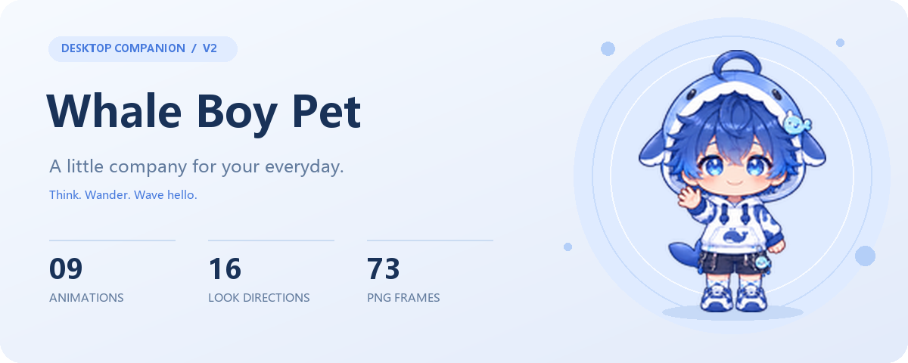

  <a href="README.zh-CN.md">中文</a> · <strong>English</strong>

  A blue-haired boy in a whale hoodie, here to think, wait, and wave with you.
   
  ChatGPT / Codex Mini & Pets v2 atlas · Portable PNG frames · Offline preview

  <a href="#animations">Meet the motions</a> · <a href="#get-started">Get started</a> · <a href="#technical">Under the hood</a>

---

## A little life in your day

A blink, a wave, a tiny hop. While you work, he has a few thoughts of his own.

<table>
  <tr>
    <td align="center" width="33%">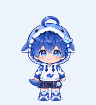 <strong>Just hanging out</strong> A breath and a blink</td>
    <td align="center" width="33%">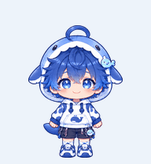 <strong>Hello there</strong> A little wave for you</td>
    <td align="center" width="33%">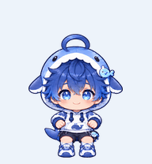 <strong>A happy little hop</strong> Up, up, and back again</td>
  </tr>
  <tr>
    <td align="center">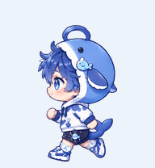 <strong>Off to the left</strong> One tiny step at a time</td>
    <td align="center">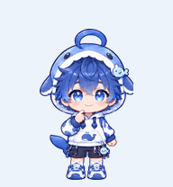 <strong>Thinking it over</strong> Something on his mind</td>
    <td align="center">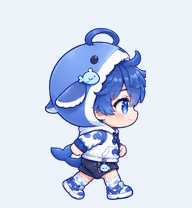 <strong>Over to the right</strong> A new spot to keep you company</td>
  </tr>
  <tr>
    <td align="center">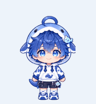 <strong>Take your time</strong> He will be right here</td>
    <td align="center">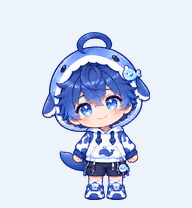 <strong>One more look</strong> Checking how things turned out</td>
    <td align="center">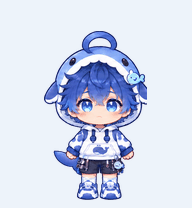 <strong>Try again tomorrow</strong> A little down, then back up</td>
  </tr>
</table>

### A glance in your direction

  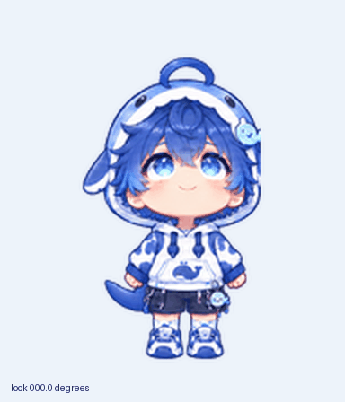
   
  16 look directions · 22.5° between frames · Mouse following in the offline preview

## Bring him along

Pick the package that fits your setup. Published packages belong in the repository's **Releases**; local packages are in `dist/`.

| You want to… | Pick this package | What's inside |
| --- | --- | --- |
| Use him in ChatGPT / Codex | `whale-boy-chatgpt.zip` | v2 atlas and `pet.json` |
| Preview or adapt him to another pet app | `whale-boy-portable.zip` | 73 PNG frames, animation JSON, README GIFs, offline preview, and dedicated configuration |

**Meet him in your browser**

1. Extract `whale-boy-portable.zip`.
2. Open `preview.html` in your browser.
3. Pick an animation, change the speed, or turn on mouse following.

No dependencies or server needed. Keep the extracted folder structure intact.

You can also clone or download the complete repository and open `preview.html` at its root. To publish a static site, upload the repository files with their directory structure intact.

**Use him in ChatGPT / Codex**

Extract the dedicated package and use the import option available in your version: ZIP, `spritesheet.png`, or a pet folder containing `pet.json`. The configuration sets `spriteVersionNumber: 2`, and the atlas has passed the ChatGPT Pets structural preflight. Import options and directional looking depend on the application version.

**Adapt him to another pet app**

The portable package includes individual transparent PNGs and animation timing. Map the state names, frame paths, and look directions to the target application's format. Some apps will need a configuration adapter.

## Under the hood

<strong>Animation mapping and atlas specifications</strong>

| Motion | State | Frames |
| --- | --- | ---: |
| Breathing and blinking | `idle` | 6 |
| Moving right | `running-right` | 8 |
| Moving left | `running-left` | 8 |
| Waving | `waving` | 4 |
| Jumping | `jumping` | 5 |
| Setback and recovery | `failed` | 8 |
| Waiting | `waiting` | 6 |
| Thinking | `running` | 6 |
| Reviewing | `review` | 6 |
| Directional looking | `lookDirections` | 16 |

`running` represents a task in progress and plays the thinking animation. Locomotion uses `running-right` and `running-left`.

- **Frame:** 192 × 208 px, transparent PNG.
- **v2 atlas:** 1536 × 2288 px, 8 columns × 11 rows.
- **Layout:** the first 9 rows follow the animation order above, with unused cells transparent; the last 2 rows hold 16 look directions.
- **Directions:** clockwise from up at 0°, in 22.5° steps.
- **Portable schema:** `portable-pet/1`, with frame durations in milliseconds.

<strong>Deployment files</strong>

| Path | Purpose |
| --- | --- |
| `docs/media/` | Covers and README GIFs included in the repository |
| `assets/frames/` | 73 transparent PNG frames |
| `assets/pet.json` | Portable animation timing and look directions |
| `dist/chatgpt/` | Dedicated configuration and atlas |
| `preview.html` | Offline animation and gaze preview |

All runtime assets are included. No build step is needed to use or deploy the project. The offline preview reads the final atlas directly from `dist/chatgpt/spritesheet.png`.

ZIP packages are distributed through Releases and ignored by Git. Runtime assets and README images are included in the repository.

---

  <strong>A small reason to smile when you look up.</strong>
    
  Project code is released under the <a href="LICENSE">MIT License</a>.

