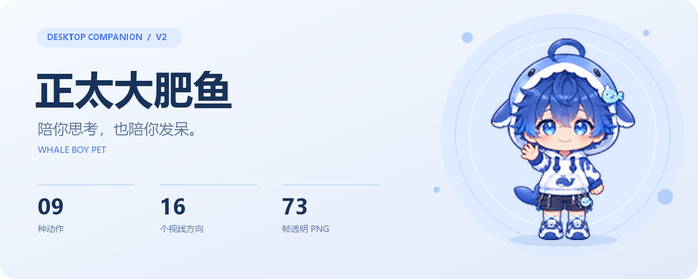
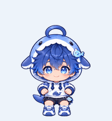
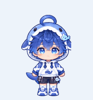
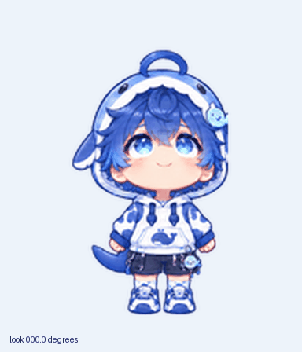

  

  <strong>中文</strong> · <a href="README.md">English</a>

  一个戴着蓝白鲸鱼帽的小少年，陪你思考、等待，也为你挥手。
   
  ChatGPT / Codex Mini & Pets v2 精灵图 · 通用 PNG 帧 · 离线预览

  <a href="#animations">看看动作</a> · <a href="#get-started">开始使用</a> · <a href="#technical">技术细节</a>

---

## 每天，都有一点小动静

呼吸、眨眼、挥挥手。你忙的时候，他也有自己的小心思。

<table>
  <tr>
    <td align="center" width="33%"> <strong>安静陪伴</strong> 呼吸与眨眼</td>
    <td align="center" width="33%"> <strong>和你打招呼</strong> 挥挥小手</td>
    <td align="center" width="33%"> <strong>开心一下</strong> 起跳、腾空、落地</td>
  </tr>
  <tr>
    <td align="center"> <strong>向左逛逛</strong> 迈着小步子</td>
    <td align="center"> <strong>认真想想</strong> 托腮思考中</td>
    <td align="center"> <strong>向右走走</strong> 换个地方陪你</td>
  </tr>
  <tr>
    <td align="center"> <strong>等你回来</strong> 不着急，慢慢来</td>
    <td align="center"> <strong>再看一眼</strong> 检查一下结果</td>
    <td align="center"> <strong>下次再试</strong> 失落一下，又打起精神</td>
  </tr>
</table>

### 视线也会跟着你

  
   
  16 个视线方向 · 每隔 22.5° 一帧 · 在离线预览里可跟随鼠标

## 把他带到桌面上

选择适合你的包。发布后可从仓库的 **Releases** 下载；本地安装包位于 `dist/`。

| 你想做什么 | 选择这个包 | 包里有什么 |
| --- | --- | --- |
| 用于 ChatGPT / Codex | `whale-boy-chatgpt.zip` | v2 精灵图与 `pet.json` |
| 预览动作、移植到其他桌宠 | `whale-boy-portable.zip` | 73 帧 PNG、动作 JSON、README 动图、离线预览及专用配置 |

**先玩一会儿**

1. 解压通用素材包 `whale-boy-portable.zip`。
2. 用浏览器打开 `preview.html`。
3. 切换动作、调整速度，或打开鼠标视线跟随。

无需安装依赖或启动服务器。请保留解压后的目录结构。

也可以直接克隆或下载完整仓库，打开根目录的 `preview.html`。发布静态网页时，将仓库文件保持目录结构上传即可。

**用于 ChatGPT / Codex**

解压专用包，按目标版本提供的入口导入 ZIP、`spritesheet.png`，或包含 `pet.json` 的宠物目录。配置采用 `spriteVersionNumber: 2`，精灵图已通过 ChatGPT Pets 结构预检。导入入口与视线支持取决于应用版本。

**移植到其他桌宠**

通用包提供独立透明 PNG 和动作时长配置。根据目标软件的格式映射状态、帧路径与视线方向即可；不同软件可能需要适配配置。

## 给喜欢折腾的你

<strong>动作映射与精灵图规格</strong>

| 动作 | 状态名 | 帧数 |
| --- | --- | ---: |
| 呼吸、眨眼 | `idle` | 6 |
| 向右移动 | `running-right` | 8 |
| 向左移动 | `running-left` | 8 |
| 挥手 | `waving` | 4 |
| 跳跃 | `jumping` | 5 |
| 失落与恢复 | `failed` | 8 |
| 等待 | `waiting` | 6 |
| 托腮思考 | `running` | 6 |
| 检查结果 | `review` | 6 |
| 十六方向环视 | `lookDirections` | 16 |

`running` 表示任务处理中，采用思考动作。左右移动分别使用 `running-right` 与 `running-left`。

- **单帧：**192 × 208 px，透明 PNG。
- **v2 精灵图：**1536 × 2288 px，8 列 × 11 行。
- **布局：**前 9 行依次对应上表的 9 种动作，空余单元格透明；后 2 行为 16 个视线方向。
- **方向：**正上方为 0°，顺时针每隔 22.5° 排列。
- **通用配置：**`portable-pet/1`，帧时长单位为毫秒。

<strong>部署目录</strong>

| 路径 | 用途 |
| --- | --- |
| `docs/media/` | 随仓库提供的封面和 README 动图 |
| `assets/frames/` | 73 个透明 PNG 帧 |
| `assets/pet.json` | 通用动作、帧时长和视线配置 |
| `dist/chatgpt/` | 专用配置与精灵图 |
| `preview.html` | 离线动画与视线预览 |

仓库包含全部运行素材，使用与部署无需构建步骤。最终精灵图位于 `dist/chatgpt/spritesheet.png`，离线预览直接读取该文件。

ZIP 安装包通过 Release 分发，默认由 Git 忽略；运行素材与 README 图片随仓库提供。

---

  <strong>愿你每次抬眼，都有一个小小的好心情。</strong>
    
  项目代码采用 <a href="LICENSE">MIT License</a>。

